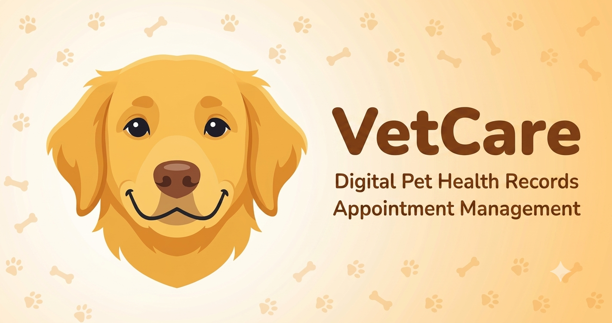

<div align="center">
  <a href="./public/opengraph.png" target="_blank">
    
  </a>
</div>

# VetCare

A modern, responsive landing page for a veterinary clinic built with **Next.js 16**, **shadcn/ui**, **Tailwind CSS v4**, and **Lucide icons**. Features a teal + orange design system, dark mode support, and fully accessible markup.

## Tech Stack

- **Framework:** Next.js 16 (App Router, Turbopack)
- **UI:** shadcn/ui + Radix UI primitives
- **Styling:** Tailwind CSS v4
- **Icons:** Lucide React
- **Dark Mode:** next-themes
- **Fonts:** Inter + Geist Mono (via next/font)

## Sections

- **Navbar** — Floating, responsive, dark mode toggle, mobile drawer
- **Hero** — Gradient background, stats cards, dual CTA
- **Services** — 6 service cards (Checkup, Vaccinations, Surgery, Dental, Grooming, Emergency)
- **About** — Clinic story, credentials, trust indicators
- **Testimonials** — 4 client reviews with star ratings
- **Contact** — Booking form + contact details
- **Footer** — Sitemap links, copyright

## Getting Started

```bash
npm install
npm run dev
```

Open [http://localhost:3000](http://localhost:3000). Press **`d`** to toggle dark mode.

## Commands

| Command | Description |
|---------|-------------|
| `npm run dev` | Start dev server |
| `npm run build` | Production build |
| `npm run start` | Start production server |
| `npm run lint` | Run ESLint |
| `npm run typecheck` | Run TypeScript check |
| `npm run format` | Format with Prettier |